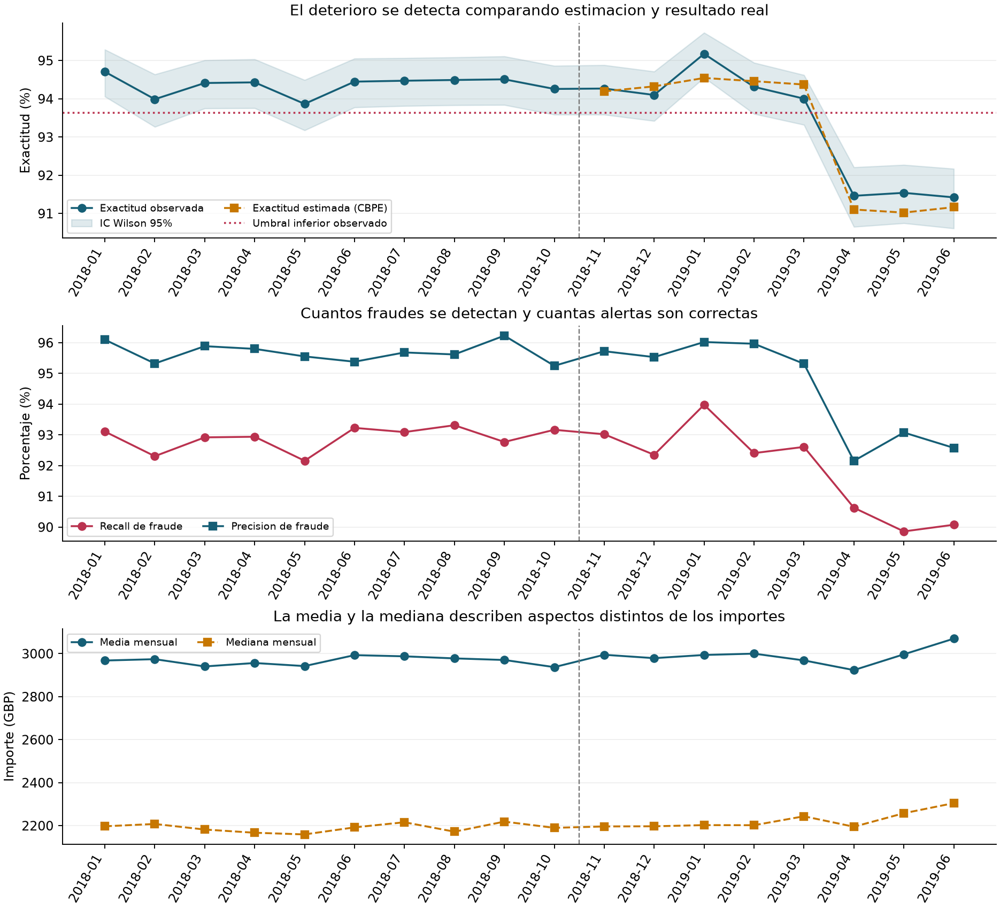
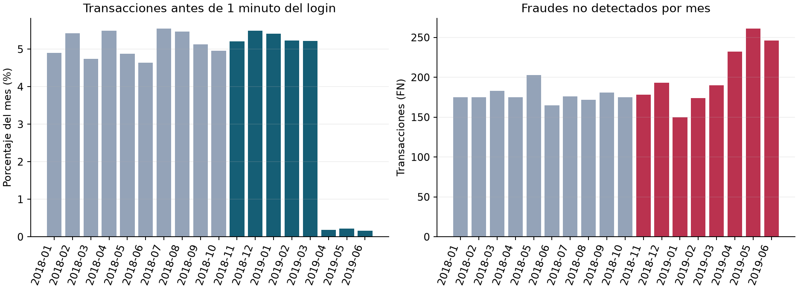

# Monitoreo de un modelo de fraude financiero

**Hector Americo Torres Huamani · Proyecto de portafolio en ciencia de datos**


¿Cómo detectar que un modelo de fraude pierde rendimiento después de desplegarse? Este proyecto compara la exactitud estimada sin etiquetas mediante **CBPE** con la exactitud observada, identifica cambios en los datos y evalúa qué señales se relacionan con el deterioro.

**Resultado principal:** abril, mayo y junio de 2019 presentan alertas conjuntas. La exactitud agregada cae de **94,37 % a 91,48 %** entre los periodos de producción estable y de alerta. La deriva de `time_since_login_min` presenta la mayor asociación con el cambio de rendimiento.

> Desarrollado a partir del proyecto educativo [Monitoring a Financial Fraud Detection Model](https://app.datacamp.com/learn/projects/2104) de DataCamp. El escenario, el enunciado y los datos proceden de DataCamp; este repositorio reúne mi solución, su validación y una ampliación del análisis. Es un trabajo de portafolio independiente, sin afiliación ni respaldo institucional de DataCamp.

## Explorar el proyecto

- **[Notebook ejecutado y explicado](Monitoreo_fraude.ipynb)**: contexto, código, tablas, gráficos y conclusiones.
- **[Reporte final en PDF](docs/Reporte_final.pdf)**: metodología, resultados y aprobación del corrector.
- **[Guía del código en español](docs/Guia_codigo_paso_a_paso.pdf)**: material para estudiar y exponer el proyecto.
- **[Datos y diccionario](data/README.md)** · **[Metodología y límites](docs/Metodologia.md)** · **[Resultados calculados](output/final/answers.json)**.

## Contexto y objetivos

El caso educativo sitúa el análisis en el seguimiento de un detector de fraude de un banco británico. Las predicciones ya están calculadas: el trabajo consiste en **monitorear y diagnosticar** el modelo. Se utilizan 50 207 transacciones de referencia y 39 967 de producción, con cinco variables de entrada y cuatro campos de fecha, etiqueta y predicción.

Las preguntas del proyecto son:

1. ¿Qué meses tienen alertas tanto en la exactitud estimada como en la observada?
2. ¿Qué variable con deriva está más correlacionada con el cambio de rendimiento?
3. ¿Cuál es el importe medio mensual que activa una alerta?

## Resultados

| Pregunta | Respuesta obtenida |
|---|---|
| Meses con alertas conjuntas | `april_2019`, `may_2019`, `june_2019` |
| Variable con mayor correlación | `time_since_login_min` |
| Importe medio del mes alertado | **3 069,8184 GBP**, junio de 2019 |

La media alertada supera el límite superior aprendido de **3 021,4111 GBP**. Son valores distintos: uno es la estadística observada y el otro el umbral del monitor.



### Interpretación

- La exactitud pasa de **94,37 %** en noviembre–marzo a **91,48 %** en abril–junio: una caída de **2,90 puntos porcentuales**, calculada antes de redondear. Se agregan transacciones de cada fase; no se promedian porcentajes mensuales sin ponderación.
- CBPE aproxima el rendimiento observado con un error absoluto medio de **0,322 puntos porcentuales** en los ocho meses de producción.
- La asociación de la deriva de `time_since_login_min` con el cambio absoluto de rendimiento es alta (Pearson **0,9704**). No equivale a importancia del modelo ni demuestra causalidad.
- Las operaciones realizadas antes de un minuto del login pasan de **5,31 % a 0,19 %**. El cambio afecta a ambas clases; deben investigarse captura de datos, cambios de aplicación y composición de usuarios.
- Enero de 2019 activa una alerta de exactitud observada **alta**, pero no una alerta conjunta. Una alerta estadística no implica siempre deterioro.



## Proceso y mejoras

1. **Auditoría:** esquema, nulos, dominios, fechas, duplicados y huellas de los archivos.
2. **Análisis previo:** métricas mensuales de clasificación, calibración e importes.
3. **Primera prueba:** CBPE, exactitud observada, deriva univariante y media mensual.
4. **Revisión:** alineación de meses y contraste independiente con pandas y scikit-learn.
5. **Mejora:** ranking limitado a producción, nulos categóricos explícitos, Spearman, exclusión de un mes y ajuste por comparaciones múltiples.
6. **Entrega:** resultados reproducibles, notebook ejecutado, dos informes y aprobación de DataCamp.

La ampliación aporta auditoría, comparación entre pruebas, evaluación por fases, sensibilidad estadística y documentación de límites. Las tres respuestas solicitadas se mantienen después de estas mejoras.

## Reproducir el análisis

Entorno validado: **Python 3.11** y versiones fijadas en [requirements.txt](requirements.txt). Los resultados del notebook se pueden leer en GitHub sin instalar nada. Para recalcularlos necesitas obtener los CSV originales siguiendo [estas instrucciones](data/README.md).

```bash
git clone https://github.com/hectortorres26/financial-fraud-model-monitoring.git
cd financial-fraud-model-monitoring
python -m venv .venv
```

Activa el entorno con `.venv\Scripts\Activate.ps1` en PowerShell o `source .venv/bin/activate` en macOS/Linux. Después:

```bash
python -m pip install -r requirements.txt
python src/analisis.py --stage all
python scripts/verificar_resultados.py
```

Para trabajar de forma interactiva, abre `Monitoreo_fraude.ipynb` en VS Code con la extensión Jupyter y selecciona el intérprete de `.venv`. También puedes instalar JupyterLab (`python -m pip install jupyterlab`) y abrirlo con `jupyter lab`. Ejecuta las celdas en orden desde la raíz del repositorio. `src/solucion_datacamp.py` contiene la solución compacta para el entorno del ejercicio; ejecútala desde la raíz si usas los datos locales.

## Estructura

```text
Monitoreo_fraude.ipynb        # Notebook completo con salidas
src/analisis.py              # Pipeline reproducible y diagnóstico
src/solucion_datacamp.py     # Solución compacta del ejercicio
data/README.md              # Obtención de datos y diccionario
docs/                       # Reporte, guía y metodología
output/                     # Tablas agregadas, figuras y auditoría
evidence/                   # Evidencia de aprobación
scripts/                    # Verificación de resultados
requirements.txt            # Versiones del entorno
```

## Validación y alcance

La solución fue **aprobada por el corrector de DataCamp el 9 de noviembre de 2026**, con 1 500 XP. Consulta la [evidencia de aprobación](evidence/datacamp_aprobado.jpg). Esto acredita las respuestas del ejercicio; la discusión estadística ampliada se sustenta en los cálculos del repositorio.

El notebook se ejecutó sin errores. La exactitud coincide con scikit-learn y la media con pandas con tolerancia `1e-12`; la estimación CBPE excluye las etiquetas de producción y los resultados de ambas pruebas conservan las respuestas finales.

Solo hay ocho meses de producción. La correlación de Spearman es menor y no significativa en esta muestra, por lo que la señal parece estar dominada por el cambio entre regímenes. La proporción de fraude del conjunto ronda el 50 % y no representa necesariamente una cartera bancaria real. No se entrenó ni reentrenó un modelo, y no se cuantifican ahorros o pérdidas reales.

## Conclusiones y próximos pasos

El deterioro comienza en abril de 2019 y puede anticiparse con probabilidades del modelo antes de disponer de las etiquetas. La señal del tiempo desde login ayuda a priorizar una investigación de datos y comportamiento. El aumento del importe medio en junio aporta otra alerta, pero no explica por sí solo la pérdida de rendimiento.

Los siguientes pasos serían revisar la medición del login, analizar errores por segmento, monitorizar recall y calibración y validar posibles cambios del detector en periodos futuros con costes operativos definidos.

## Autoría y procedencia

**Hector Americo Torres Huamani** — [GitHub](https://github.com/hectortorres26).

Fuente educativa: **DataCamp, proyecto 2104**. Los archivos originales se obtienen desde la plataforma y no se redistribuyen aquí. Los nombres de productos y sus materiales pertenecen a sus respectivos titulares. El repositorio presenta la implementación y el análisis del ejercicio como trabajo de portafolio, con su procedencia explícita.
